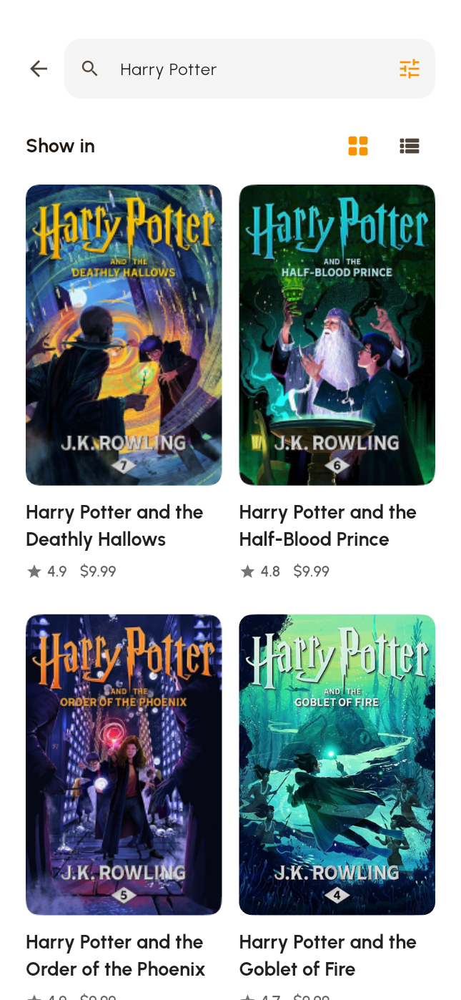
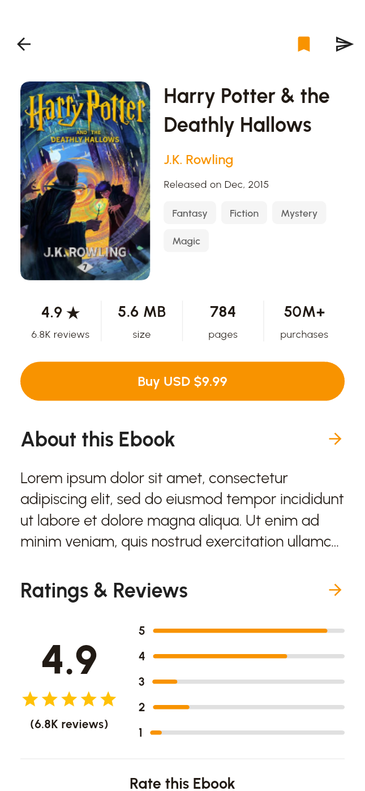
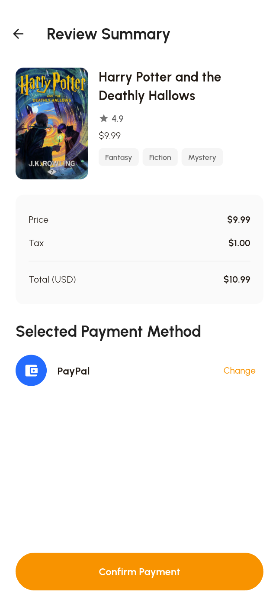
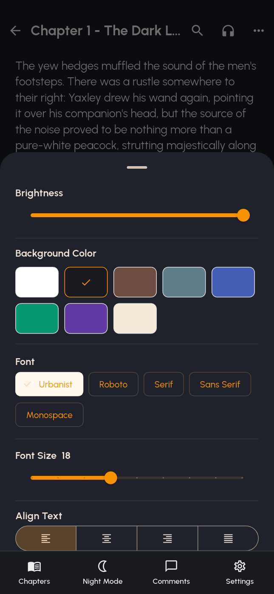
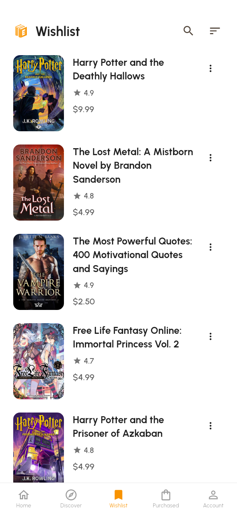
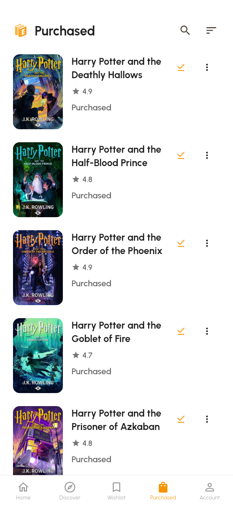
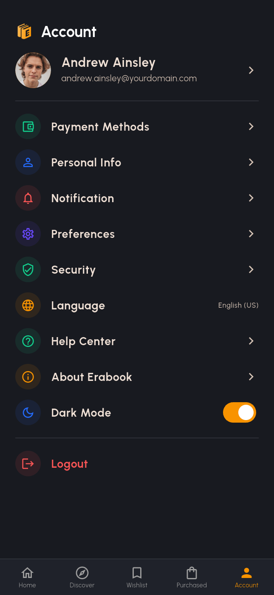

# Erabook · Flutter 电子书商店与阅读器

Erabook 是基于 Pixso **Erabook - Ebook Store & Reader App UI Kit** 实现的 Android 优先 Flutter 演示应用。从首页发现电子书，搜索并筛选结果，加入愿望清单，完成模拟购买，再从书架打开阅读器。账户页可切换浅色和深色外观。

## 主要界面

| 欢迎 | 首页 | 搜索结果 |
| --- | --- | --- |
|  |  |  |

| 书籍详情 | 购买确认 | 阅读设置 |
| --- | --- | --- |
|  |  |  |

| 愿望清单 | 已购书架 | 深色账户 |
| --- | --- | --- |
|  |  |  |

[完整截图与 Pixso 节点索引](docs/SCREENS.md)按画板编号列出浅色和深色截图。

## 功能

| 模块 | 可操作内容 |
| --- | --- |
| 引导与账户 | 五步注册、本地登录校验、验证码演示、密码重置界面、资料编辑、退出 |
| 商店 | 首页推荐、发现、题材浏览、通知和空状态、关键词搜索、卡片与列表切换、筛选和排序 |
| 电子书 | 免费与付费详情、简介、系列、愿望清单、分享菜单、评分和评论 |
| 购买与书架 | 添加示例付款方式、选用付款方式、确认金额、打开已购书、切换示例下载和读完状态 |
| 阅读 | 示例章节、章节侧栏、正文搜索、字体和字号、背景、对齐及亮度预览 |
| 设置 | 浅色与深色、通知与阅读偏好、语言选择、常见问题筛选和联系入口 |

## 项目结构与架构

~~~text
ErabookEbookStoreReader/
├─ lib/
│  ├─ main.dart                   # Flutter 入口
│  ├─ app.dart                    # MaterialApp、主题和系统栏
│  ├─ core/
│  │  ├─ router.dart              # 命名路由和页面参数
│  │  ├─ theme.dart               # Pixso 色板、Urbanist 和亮暗主题
│  │  └─ widgets.dart             # 按钮、书卡、列表行、输入框、确认弹窗
│  ├─ data/
│  │  ├─ models.dart              # 书籍、题材、评论、通知、示例付款方式
│  │  ├─ mock_data.dart           # 本地书目、通知、评论和示例正文
│  │  └─ app_state.dart           # ChangeNotifier 会话状态
│  └─ features/
│     ├─ onboarding.dart          # 启动、欢迎
│     ├─ auth.dart                 # 登录、注册、密码重置
│     ├─ shell.dart                # 五个底部导航标签
│     ├─ main_tabs.dart            # 首页、发现、书架和账户
│     ├─ browse.dart               # 题材、搜索、筛选、通知
│     ├─ book_detail.dart          # 书籍详情、简介、分享、评分
│     ├─ purchase.dart             # 模拟结算和付款方式
│     ├─ reader.dart               # 阅读、章节和排版设置
│     ├─ review.dart               # 评论编辑和提交
│     └─ settings.dart             # 账户设置和帮助
├─ assets/                        # Pixso 导出素材、书封、题材图和 Urbanist 字体
├─ design_reference/              # Pixso 画板参考图
├─ screenshots/light/             # 浅色 Flutter 截图
├─ screenshots/dark/              # 深色 Flutter 截图
├─ docs/SCREENS.md                 # 114 个应用状态的截图和画板节点
├─ android/                        # Android 工程
├─ test/                           # 设计标记和本地目录检查
├─ integration_test/               # Android 页面流程和截图测试
├─ test_driver/                    # 将 Android 测试截图写入项目
└─ tool/capture.ps1                # 复用现有模拟器并恢复显示配置
~~~

界面通过 Flutter Navigator 跳转。功能页组合共享组件，从本地目录取得书籍、题材和样例。跨页面的主题、书架、付款方式、评论和账户信息由 `AppState` 管理，页面输入和布局切换留在对应 Widget 内。运行时使用 Flutter SDK，截图测试使用 SDK 随附的 `integration_test`。

项目以本地 UI 演示为范围。状态保存在内存中，应用进程重启后恢复示例值。付款仅更新本地书架，登录、验证码、下载、分享渠道和安全设置使用演示交互。阅读器显示示例文字。语言设置记录所选项，界面文案采用英文。

## 本地运行与截图

使用项目现有 Flutter SDK（开发环境 Flutter 3.47.7 / Dart 3.13.5）和已连接的 Android 设备。

~~~powershell
flutter pub get
flutter devices
flutter run -d emulator-5554
flutter analyze
flutter test
pwsh -File tool/capture.ps1 -Device emulator-5554
~~~

截图脚本在 Android 11 模拟器上临时采用 430 × 932 逻辑像素视口，输出 645 × 1398 PNG，并恢复设备原有分辨率和密度。截图显示应用内容。Android 系统键盘、状态栏和导航栏由系统绘制。

本地体验可直接使用登录表单里的示例值。密码重置的演示验证码为 `4672`。
